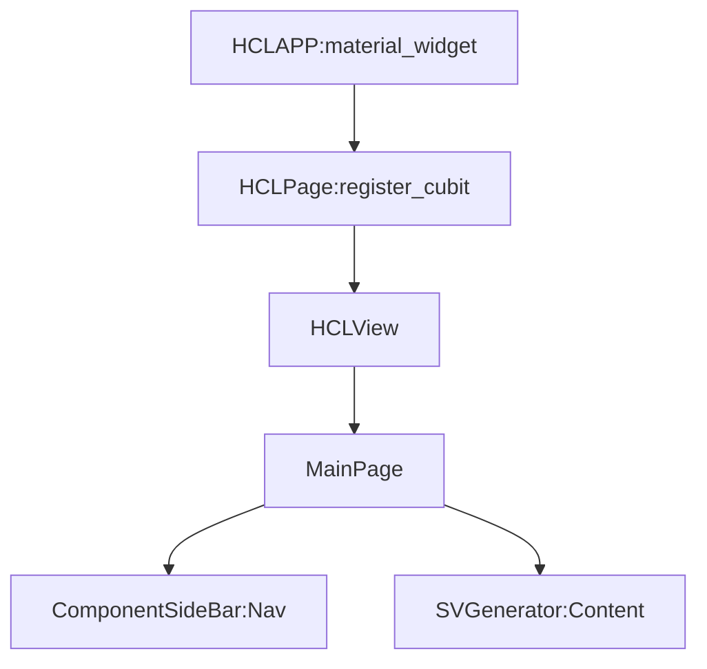

# ROHD-HCL Configuration App

The Flutter configuration app exposes selected ROHD-HCL components through
editable configuration knobs and presents generated ROHD schematics, ROHD
source, SystemVerilog, and synthesized schematics.

For workspace setup, dependency sources, running the app, and browser
validation, see [DEVELOPER.md](DEVELOPER.md).

## Adding a component to Confapp

Adding a reusable library component and making it configurable are related but
separate steps. The component must first be implemented, exported, documented,
and tested in the root package. Then complete the following Confapp work.

### 1. Create a configurator

Add a `Configurator` implementation under
`lib/src/component_config/components/`. It supplies:

- the user-facing `name`;
- `category` and `subcategory` metadata for the component menu;
- a `Map<String, ConfigKnob<dynamic>>` describing editable settings; and
- `createModule()`, which constructs the configured ROHD module.

Follow an existing configurator for the relevant component family. Keep the
configurator's default settings buildable and useful for schematic generation.

Integer parameters use an editable numeric stepper with inline validation.
Most counts, widths, and depths use `PositiveIntConfigKnob` (starting at 1).
Use `NonNegativeIntConfigKnob` only where zero is a meaningful hardware
configuration, such as an absent APB user channel, zero latency, or a
zero-depth shift register. Ordinary `IntConfigKnob`
still supports signed values; `minValue` can express stricter lower limits,
such as radix or synchronizer stages starting at 2. No application-wide maximum
is imposed. Module-specific relationships between parameters are still checked
by the component.

Each control starts at the knob's configured default, accepts decimal and
hexadecimal (`0x...`) input, and disables decrement at the lower bound.
Invalid or out-of-range text shows an error and prevents generation without
changing the last valid knob value. Optional integer controls also use the
stepper; clearing one selects its inferred/default value (`null`). Their static
values remain signed unless the parameter declares a lower bound.

Saved JSON retains its existing value shape. Invalid integer strings and
values below a declared lower bound now report errors on loading or
programmatic assignment instead of silently retaining an older value.

### 2. Register it

Add an instance to
[`componentRegistry`](../lib/src/component_config/components/component_registry.dart).
The registry supplies the Confapp sidebar through
[`ComponentCubit`](lib/hcl/cubit/component_cubit.dart) and is also consumed by
[`gen/generate.dart`](../gen/generate.dart) for documentation netlists.

Confapp reads `Configurator.category` and `Configurator.subcategory` directly;
no Dart annotations, reflection, or generated registry are required. This is
the same classification approach as the `communication-components` branch.
Only registered configurators appear in the menu.

The compact sidebar shows expandable categories in taxonomy order, with
alphabetically sorted, expandable subcategory groups. Both levels start collapsed
and retain independent expansion state. Empty categories are hidden. Component
names are
alphabetical within each group. Subcategory IDs such as `floating-point` are
displayed as `Floating Point`; the stable IDs and component names used in saved
configurations are unchanged. Collapsing a group does not change the selection
or discard its configuration.

### 3. Add ROHD source mapping

Map every concrete module runtime type that the configurator can create in
[`moduleSourceAssets`](lib/hcl/module_source_assets.dart). This enables the
ROHD Source view. Confapp activates ROHD source tracing before constructing a
module and generates FLC data separately from the schematic netlist. It supplies
an explicit logical package root and package map, avoiding filesystem discovery
on web. FLC retains `lib/src/` paths, which Confapp maps to bundled `rohd_src/`
assets. The same SystemVerilog service supplies the displayed text and its
cross-probe line positions. Point to the source path beneath `lib/src/`, using
the `rohd_src/` asset prefix.

Run the source asset generator from the repository root after source changes:

```bash
bash tool/generate_confapp_assets.sh
```

It mirrors `lib/src/` into the ignored `confapp/assets/rohd_src/` directory and
updates the generated asset-directory list in `confapp/pubspec.yaml`.

Source cross-probing requires Dart source locations in the recorded stack
traces, as supplied by Flutter's debug web compiler (DDC). Optimized `dart2js`
builds can report JavaScript locations instead; the explicit package map does
not translate those back to Dart without source-map support.

### 4. Verify all generated views

Confapp builds the selected module and generates:

- native ROHD netlist JSON for `rohd_schematic_viewer`;
- generated SystemVerilog;
- a Yosys synthesized schematic when enabled; and
- source-navigation data from ROHD source tracing.

Exercise the default configurator values and representative knob values in the
running app. Confirm the ROHD Source view reaches the mapped asset and that
schematic generation does not rely on external signals crossing a module
boundary. Confirm schematic selections navigate to the matching source
locations.

### 5. Add regression coverage

At minimum:

- add functional and nested-composition tests for the component in `test/`;
- update tests for changed configurator defaults or knobs; and
- run
  [`module_source_assets_test.dart`](test/hcl/module_source_assets_test.dart)
  to verify registry and bundled-source coverage.

Run the tracing regression on both the VM and DDC web runtime:

```bash
cd confapp
flutter test test/hcl/view/screen/flc_trace_data_test.dart test/hcl/view/hcl_page_test.dart
flutter test --platform chrome test/hcl/view/screen/flc_trace_data_test.dart
```

## Widget Tree



----------------

Copyright (C) 2023-2026 Intel Corporation
SPDX-License-Identifier: BSD-3-Clause
